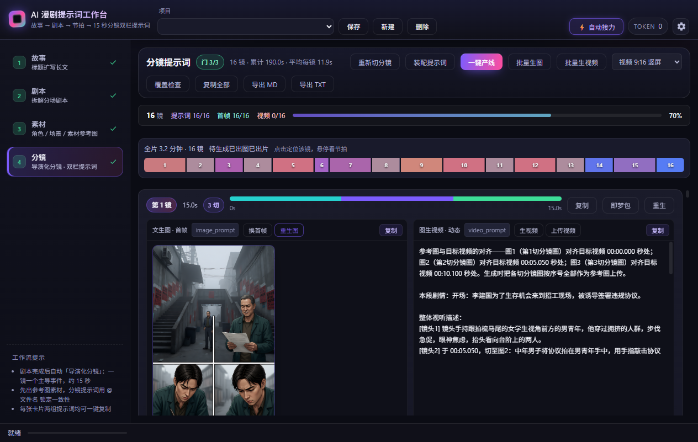

# AI 漫剧提示词工作台

面向「文生图出首帧 → 图生视频出动作」链路的桌面工具：**给一个标题或一段简介，自动产出逐镜 5/10/15 秒、可直接在即梦（Seedance）出片的分镜提示词与「即梦导出包」**，每镜配可视化时长龙骨彩条、连贯性告警与一键复制。

> 更多教程、案例与更新请访问作者官网：**[www.glgxt.cn](https://www.glgxt.cn)**
> 在线介绍页：**[676077263.github.io/AIComicPrompt](https://676077263.github.io/AIComicPrompt/)**

---

## 下载安装

1. 前往 [**Releases**](https://github.com/676077263/AIComicPrompt/releases/latest) 页面，下载 `AIComicPromptInstaller.exe`（约 300 MB，单文件安装包）。
2. 双击运行，按提示完成安装。
3. 从桌面或开始菜单启动「AI 漫剧提示词工作台」。

**系统要求**：Windows 10 / 11（64 位）；首次使用需联网调用模型服务。

**技术形态**：C++17 原生宿主 + WebView2 界面，内置 Python 运行时，安装即用，无需额外配置环境。

---

## 首次使用（重要）

- **软件不内置任何模型 API Key**：首次使用请打开「设置 → 接口配置」，选择模型厂商并**填写你自己的 API Key**，点击「测试连接」确认灯变绿。
- 内置厂商预设（均为 OpenAI 兼容协议，也可自行新增任意兼容厂商）：

| 厂商 | 说明 |
| --- | --- |
| 百度千帆 Token Plan 个人版 | 默认选中 |
| DeepSeek | deepseek-chat / reasoner |
| 智谱 GLM | glm-4 系列 |
| 月之暗面 Kimi | moonshot-v1 系列 |
| 阿里百炼 Qwen | 兼容模式 |
| 硅基流动 SiliconFlow | Qwen / DeepSeek 开源模型 |
| 火山方舟 Ark | doubao 系列 |
| Agnes 3.0 Flash | 文本 / 生图 / 生视频 |

---

## 核心功能：六步流水线

| 步骤 | 做什么 | 产物 |
| --- | --- | --- |
| ① 故事大纲 | 填标题/简介/短文，选篇幅、题材、画风 | 故事框架 |
| ② 剧本 | 由大纲拆解 | 分场剧本（场景/出场/行动/对白/转折） |
| ③ 导演化分镜 | 剧本一次直出分镜 | 分镜卡：每镜 5/10/15 秒、2-4 切宫格、运镜与因果链 |
| ④ 素材 | 提取角色/场景/道具并生成设定图 | 角色立绘 3:4、场景空镜 16:9、道具特写 1:1 |
| ⑤ 装配提示词 | 本地纯程序拼接，秒级完成 | 每镜 `image_prompt`（宫格分镜表）+ `video_prompt`（时间轴母版） |
| ⑥ 出图 / 出片 | 宫格首帧 → 自动裁切 → 导出即梦包 | 首尾帧版 / 全能参考版（`@图片N` 映射 + 上传清单） |

### 功能亮点

- **宫格分镜（multi-grid）**：默认一镜一张 2×2 宫格（2-4 切），即梦 2.0 / mini 人物一致性最稳的密度；出图后自动按行优先裁出每切。
- **首尾帧版导出**：同场相邻镜尾帧 = 下一镜首切，动接动无缝拼接；换场自动定场收尾。
- **全能参考版导出**：`@图片N` 按上传顺序映射整宫格、角色立绘、场景图与尾帧，锁脸锁场景；「图片快捷分类」按钮自动整理上传顺序清单。
- **连贯性零 LLM 校验**：装配时逐镜检查因果链、入场、定场、机位、对白容量、切数上限等 8 类问题，标红提示复核。
- **时长自动适配**：按对白字数自动升档 5→10→15 秒，宁可画面留白也不压台词；长剧本按章/场边界自动分批。

---

## 相关链接

- 作者官网（教程 / 案例 / 更新）：**[www.glgxt.cn](https://www.glgxt.cn)**
- 问题反馈：请通过官网联系方式联系作者

---

**版权声明**：本软件版权归作者所有，仅供个人学习创作使用，请勿二次分发安装包。
